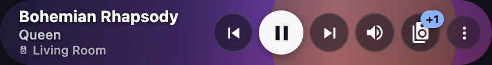
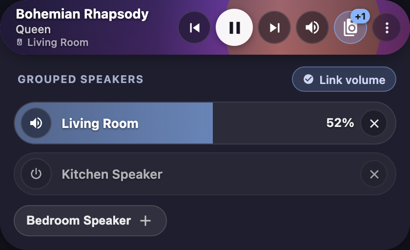
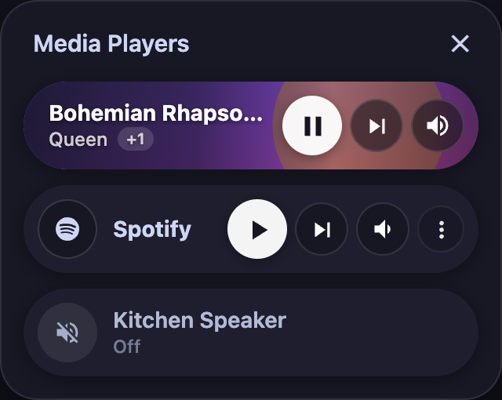

# Handoff Note — `v0.30.0-brian.7` (Decoupled Speaker Grouping, Custom Join/Unjoin Services & Sensor Groups)

## 1. Card Type

- **Unchanged**: Still `custom:mediocre-media-player-card` (as well as `custom:mediocre-massive-media-player-card`, `custom:mediocre-multi-media-player-card`, and `custom:mediocre-chip-media-player-group-card`).
- **Added / Renamed / Removed Card Types**: None.

---

## 2. Config Diff Against `v0.30.0-brian.2`

In `v0.30.0-brian.7`, three optional keys were added to `speaker_group` to decouple speaker grouping from native Home Assistant `media_player.join`/`media_player.unjoin` and support sensor-based group state (e.g. Nuvo multi-zone matrix systems):

| Option                             | Type      | Default     | Change vs `v0.30.0-brian.2`                                                                                                                                                                                                                                                       |
| ---------------------------------- | --------- | ----------- | --------------------------------------------------------------------------------------------------------------------------------------------------------------------------------------------------------------------------------------------------------------------------------- | --- | --------------------- |
| `speaker_group.self_entity_id`     | `string`  | `undefined` | **New in `brian.7`**. The card's own zone entity (e.g. `media_player.kitchen`). Excluded from the grouped member volume sliders and ungrouped chips, and treated as the group anchor. If unset, falls back to `speaker_group.entity_id                                            |     | entity_id` as before. |
| `speaker_group.join_service`       | `string`  | `undefined` | **New in `brian.7`**. Custom action (e.g. `script.music_zone_group_join`) invoked when tapping a `+` chip, called with `{ group: <speaker_group.entity_id>, member: <tapped entity id> }` instead of calling `media_player.join`. When set, `media_player.turn_on` is not called. |
| `speaker_group.unjoin_service`     | `string`  | `undefined` | **New in `brian.7`**. Custom action (e.g. `script.music_zone_group_unjoin`) invoked when tapping a `✕` button on a member volume pill, called with `{ group: <speaker_group.entity_id>, member: <tapped entity id> }` instead of calling `media_player.unjoin`.                   |
| `speaker_group.entity_id`          | `string`  | `undefined` | Now supports sensors (e.g. `sensor.kitchen_stream_group`). The card reads `group_members` from this entity's attributes. It is no longer assumed to be a `media_player` (its state, domain, and volume are not read or targeted).                                                 |
| `options.show_volume_step_buttons` | `boolean` | `false`     | Renders circular `-` / `+` step buttons (`±5%` or `volume_up`/`volume_down`) inside the right side of the full-card Bubble volume slider overlay and inside the grouped speaker Bubble volume pills.                                                                              |
| `options.always_show_power_button` | `boolean` | `false`     | When `false` (default), no separate power button is rendered in the `off` state because **tapping anywhere on the off card pill** toggles power on (`media_player.toggle`). When `true`, an explicit circular `mdi:power` button is rendered on the right.                        |

---

## 3. Breaking Changes & Compatibility Audit

All configurations from `v0.30.0-brian.2` remain valid and do not fail validation, though the card's visual presentation and dimensions have changed significantly:

- **`entity_id`**: Unchanged.
- **`name`**: Unchanged. Used for the room name line when `on`, the primary title when `off`, and the label inside the full-card volume slider.
- **`use_art_colors`**: Still supported. Note that when a track has valid album artwork (`entity_picture_local` or `entity_picture`), the artwork itself is now rendered full-bleed across the `56px` card background with a dark directional gradient scrim and white text (`#ffffff`) for guaranteed contrast.
- **`action` / `action.tap_action`**: Still supported. Previously attached to the left square `AlbumArt` thumbnail; now attached to the clickable left title/artist metadata button when the player is `on`. (When the player is `off`, tapping the card calls `media_player.toggle` to turn the player on.)
- **`speaker_group` Decoupling & Sensor Support (`brian.7`)**:
  - `speaker_group.entity_id`: Can now be a sensor entity (such as `sensor.kitchen_stream_group`). The panel and `+N` badge read `group_members` from its attributes; the card does not assume it is a `media_player` and does not query or control its state, domain, or volume.
  - `speaker_group.self_entity_id`: Specifies the anchor zone for this card (e.g. `media_player.kitchen`). It is excluded from the grouped member volume sliders and ungrouped chips. If unset, it falls back to `speaker_group.entity_id || entity_id` as in `brian.6`.
  - `speaker_group.join_service`: If specified (e.g. `script.music_zone_group_join`), tapping a `+` chip invokes this action with payload `{ group: <speaker_group.entity_id>, member: <tapped entity id> }` rather than calling `media_player.join`. `media_player.turn_on` is omitted when a custom join service is configured.
  - `speaker_group.unjoin_service`: If specified (e.g. `script.music_zone_group_unjoin`), tapping `✕` invokes this action with `{ group: <speaker_group.entity_id>, member: <tapped entity id> }` rather than calling `media_player.unjoin`.
  - Member volume pills, mute buttons, and link-volume continue to directly use each speaker's own entity from `entities` (e.g. Nuvo zone `media_player.*`).
  - **Audit of Assumptions on `speaker_group.entity_id`**: In `v0.30.0-brian.6`, `speaker_group.entity_id` was targeted by `VolumeSlider.tsx` for step adjustments and could be pushed into `availableSpeakers` as a member. In `brian.7`, `VolumeSlider.tsx` targets `speaker_group_self_entity_id ?? (isSensor ? entity_id : (speaker_group_entity_id ?? entity_id))`, `GroupVolumeController` excludes sensors and anchors, and `selectActiveMultiMediaPlayer.ts` handles `self_entity_id` anchors. When none of the new keys are configured, legacy behavior remains 100% identical.
- **`options.always_show_power_button`**: Still works (see table above).
- **`options.show_volume_step_buttons`**: Still works; renders `-` / `+` step buttons inside the full-card volume slider overlay and inside each grouped speaker volume pill.
- **`options.show_player_name`**: **Still works explicitly as in `brian.2`**, and **the device icon still hides with the name** when `show_player_name: false`. When `show_player_name: true` (default), the device icon and player name render on their own dedicated 3rd line below the artist so the artist and room name never collide horizontally. When `show_player_name: false`, `PlayerInfo` returns `null` and the 3rd line collapses completely (while any grouped speaker count `+N` is shown as a badge on the speaker group button). (Note: In the `off` state, the card always displays the player's name and `"Off"` next to the `mdi:volume-off` badge so you can identify which off speaker you are tapping to turn on.)
- **`options.show_source_selection`**: **Still works explicitly as in `brian.2`**. Setting `show_source_selection: false` hides the source selector from the `⋮` (`AdditionalActionsMenu`) overflow menu (and hides the `⋮` button entirely if no other menu items exist) as well as from the Massive popup track row.
- **Album Name on Base Card**: The base card no longer prepends `Album Name • ` before the artist (`MetaInfo.tsx` now displays only `media_artist`, or `subtitle` for TV series). Full `Album Name • Artist` metadata remains visible when clicking the title/artist to open `more-info` or `MassivePopUp` (`tap_opens_popup: true`).

---

## 4. Layout & Geometry Changes

- **Height**:
  - **Before (`brian.2`)**: Two-row layout with a left square artwork box; height varied between **`~102px`** (when `off` or without subtitle, `78px` art + `24px` padding) and **`~124px`** (when playing with subtitle, `100px` art + `24px` padding).
  - **Now (`brian.3`)**: Fixed **`56px`** single-row Bubble Card pill (`border-radius: 28px`) across **all** states (`playing`, `paused`, `idle`, `off`, and `volume slider`). The card height decreased by **`46px–68px`** and never jumps when changing states. (Expandable drawers like `SpeakerGrouping`, `Search`, `MediaBrowser`, `Queue`, and `CustomButtons` still expand vertically underneath the `56px` row when toggled open.)
- **Width & Responsive Breakpoints**:
  - Card width remains `100%` of its Lovelace container.
  - Uses CSS container queries (`container-type: inline-size` on the `56px` `cardContent` bar):
    - **`> 300px` container width** (standard desktop/tablet cards): Shows `Previous`, `Play/Pause`, `Next` + utility buttons (`Shuffle` and `Repeat` are omitted from the compact pill and remain in the popup).
    - **`<= 300px` container width** (narrow mobile popups): Hides `Previous` (`#mmpc-compact-previous-track`), leaving `Play/Pause` and `Next` + `Volume` so the song title and source name remain readable down to **`~260px`** minimum card width.
- **Control Placement & Behavior**:
  - **Off State**: Left `38px` circular badge with `mdi:volume-off` ("no sound" icon) + Player Name and `Off` subtitle. Tapping anywhere on the card calls `media_player.toggle` to turn it on.
  - **Idle / No-Artwork State**: Left `38px` circular frosted badge with the source/device icon + Title/PlayerInfo on the left, and frosted circular transport/utility buttons on the right.
  - **Playing with Artwork State**: Left circular badge collapses away; artwork fills `100%` of the card background behind a directional dark gradient scrim. Left side stacks up to 3 lines (`Song Title`, `Artist`, and `PlayerInfo` room name). Right side has frosted circular buttons (`34px` secondary buttons, `38px` white circle `Play/Pause` button, `30px` subtle utility buttons, plus a `+N` badge on the `mdi:speaker-multiple` button when grouped).
  - **Volume Slider**: Tapping `#mmpc-compact-volume-toggle` replaces the `56px` row in-place with a **full-card height & width Bubble volume slider** (`56px` tall native `<input type="range">` fill track). Left side has a `38px` circular Mute toggle button + player name; right side has live `%` text, optional `-`/`+` step buttons, speaker grouping button (`#mmpc-compact-volume-grouping-toggle` with `+N` badge when grouped), and close (`×`, `#mmpc-compact-volume-close`) button. In `v0.30.0-brian.6`, volume dragging matches Bubble Card's smooth commit-on-release behavior: zero service calls fire during drag, `media_player.volume_set` is called exactly once upon finger release, and incoming HA state echoes are ignored during drag and for a 200ms settle window.
  - **Grouped Speakers View**: When expanded, the top 56px player pill retains its rounded pill contour. Each grouped speaker is rendered as a full-width 44px Bubble volume pill with live drag/input tracking, overlaid room title, mute button, volume percentage, optional step buttons, and unjoin button. Available speakers are laid out below as frosted Bubble chips with add icons.

---

## 5. Styling Hooks

| Hook / Variable / Selector                                  | Default                                                                            | Description                                                                    |
| ----------------------------------------------------------- | ---------------------------------------------------------------------------------- | ------------------------------------------------------------------------------ |
| `--ha-card-border-radius`                                   | `28px` (set inline on `ha-card`)                                                   | Controls the outer `<ha-card>` pill border radius.                             |
| `--mmpc-meta-primary-color`                                 | `var(--primary-text-color, #fff)` (`#ffffff` when artwork is active)               | Primary song title text color in `MetaInfo`.                                   |
| `--mmpc-meta-secondary-color`                               | `var(--secondary-text-color)` (`rgba(255, 255, 255, 0.78)` when artwork is active) | Secondary artist and `PlayerInfo` pill text color.                             |
| `--mmpc-icon-button-size`                                   | `16px`–`21px` per button                                                           | Controls `<ha-icon>` size inside `IconButton`.                                 |
| `--slider-fill-color`                                       | `rgba(137, 180, 250, 0.68)`                                                        | Fill color of the full-card Bubble volume slider track in `VolumeSlider.tsx`.  |
| `#mmpc-compact-play-pause-toggle`                           | —                                                                                  | Primary `38px` circular Play/Pause button.                                     |
| `#mmpc-compact-previous-track` / `#mmpc-compact-next-track` | —                                                                                  | `34px` frosted circular Previous / Next track buttons.                         |
| `#mmpc-compact-volume-toggle`                               | —                                                                                  | `34px` frosted circular button that opens the full-card volume slider.         |
| `#mmpc-compact-volume-grouping-toggle`                      | —                                                                                  | `34px` frosted circular speaker-group button inside the volume slider overlay. |
| `#mmpc-compact-volume-close`                                | —                                                                                  | `34px` frosted circular `×` button that closes the volume slider overlay.      |
| `#mmpc-compact-grouping-toggle`                             | —                                                                                  | `34px` frosted circular speaker-group button on the main playback row.         |
| `#mmpc-compact-additional-actions-trigger`                  | —                                                                                  | `30px` frosted circular `⋮` menu trigger button.                               |

---

## 6. Configuration Examples

### Minimal Example

```yaml
type: custom:mediocre-media-player-card
entity_id: media_player.living_room
```

### Full Example (Using All Audited Options)

```yaml
type: custom:mediocre-media-player-card
entity_id: media_player.living_room
name: Living Room
use_art_colors: true
tap_opens_popup: true
action:
  tap_action:
    action: more-info
speaker_group:
  entity_id: media_player.living_room
  entities:
    - entity: media_player.living_room
      name: Living Room
    - entity: media_player.kitchen
      name: Kitchen
    - entity: media_player.bedroom
      name: Bedroom
options:
  always_show_power_button: false
  show_volume_step_buttons: false
  show_player_name: true
  show_source_selection: true
```

### Decoupled Example (Sensor Group + Nuvo Multi-Zone Matrix Scripts)

```yaml
type: custom:mediocre-media-player-card
entity_id: media_player.kitchen_stream
name: Kitchen
speaker_group:
  entity_id: sensor.kitchen_stream_group # reads group_members from sensor attributes
  self_entity_id: media_player.kitchen # card's own zone, excluded from sliders and chips
  join_service: script.music_zone_group_join # receives { group: "sensor.kitchen_stream_group", member: "media_player.brians_office" }
  unjoin_service: script.music_zone_group_unjoin # receives { group: "sensor.kitchen_stream_group", member: "media_player.brians_office" }
  entities:
    - media_player.kitchen
    - media_player.brians_office
    - media_player.covered_deck
    - media_player.family_room
options:
  show_player_name: true
  show_volume_step_buttons: true
```

---

## 7. Screenshots

### Playing State (`420px` width)



### Grouped Speakers View (`420px` width)



### Full-Card Bubble Volume Slider Active (`420px` width)


### Idle State — No Artwork (`420px` width)


### Off State — Collapsed No-Sound Badge, Tap to Turn On (`420px` width)


### Narrow Phone-Width (`320px` Popup Container / `292px` Card Width)

Shows Playing (`show_player_name: false`, `show_source_selection: false`), Idle (`show_player_name: false`), and Off cards stacked inside a narrow mobile popup:



---

## 8. Known Issues

- **Hardcoded `28px` border radius on `.card` and `<ha-card>`**: When expandable drawers (`SpeakerGrouping`, `Search`, `MediaBrowser`, `Queue`) are opened below the `56px` pill, the outer container keeps its `28px` rounded corners, which looks like a large rounded Bubble Card container. If a dashboard uses `card_mod` expecting `12px` corners, override both `ha-card` (`--ha-card-border-radius`) and `ha-card > div` (`border-radius`).
- **Multiple optional utility toggles on narrow cards**: If `search`, `media_browser`, `queue`, `speaker_group`, `custom_buttons`, and `always_show_power_button` are all enabled simultaneously on a narrow `< 350px` card, the right button row can crowd the song title. Inside narrow mobile popups, prefer keeping `always_show_power_button: false` and `show_source_selection: false` (or using the popup's own tabs).
